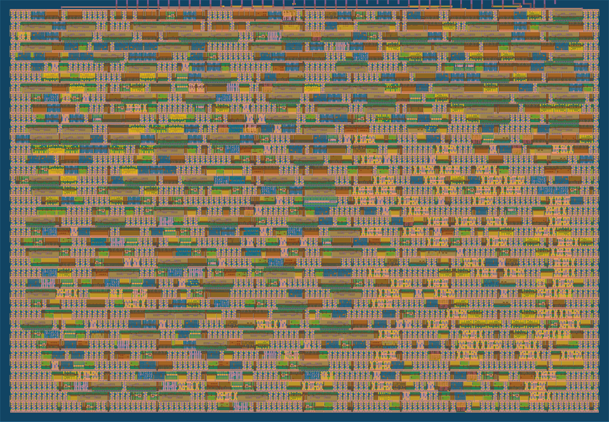

# INT8 dot products of any length, one byte per clock, in one Tiny Tapeout tile

> Newer version: [tt-int4-dot-accelerator](https://github.com/Joonsense/tt-int4-dot-accelerator), 2 INT4 MAC per clock in the same tile. [Draw a digit in the browser demo](https://joonsense.github.io/tt-int4-dot-accelerator/).



A signed INT8 dot product accelerator for a single 1x1 [Tiny Tapeout](https://tinytapeout.com) tile (SkyWater sky130),
fed over the parallel pins at one byte per clock (a0, b0, a1, b1, ...). CHAIN carries a 32-bit sum across vectors,
so dot products of any length work (no overflow up to 131,072 pairs). Designed and verified by the
[chip-lab](https://github.com/Joonsense/tt-int4-dot-accelerator#how-it-was-made) AI agent pipeline, hardened free on
GitHub Actions. **Not fabricated.**

| | |
|---|---|
| Throughput | 0.5 INT8 MAC per clock (N=8 vector every 16 clocks) |
| Area | 1x1 tile, 61.8% placement utilization |
| Timing | 50 MHz, setup slack +7.13 ns at the slow corner, no hold violations |
| Signoff | DRC 0, LVS 0, antenna 0, precheck passed |
| Gate-level tests | 10/10 incl. 500-vector stress with random stalls and backpressure, chains of 1 to 40 vectors, abort, reset |
| Real workload | `examples/digits`: 64 to 10 layer, 3,600 dot products bit identical to Python on RTL **and** on the post-layout gate netlist, 95.83% |
| Power (estimate) | about 0.50 mW at 50 MHz |

Faster sibling: [tt-int4-dot-accelerator](https://github.com/Joonsense/tt-int4-dot-accelerator), 2 INT4 MACs per clock
in the same tile (4x this design). Serial sibling: [tt-uart-dot-accelerator](https://github.com/Joonsense/tt-uart-dot-accelerator).

Protocol and pins: [docs/info.md](docs/info.md). Host drivers: `host/pin_client.py` (demo board, manual clock, `long_dot`)
and `host/pio_stream.py` (RP2040/RP2350 PIO, one byte per clock; co-simulated against the RTL, not yet tried on hardware).

```
cd test && pip install -r requirements.txt && make
```
